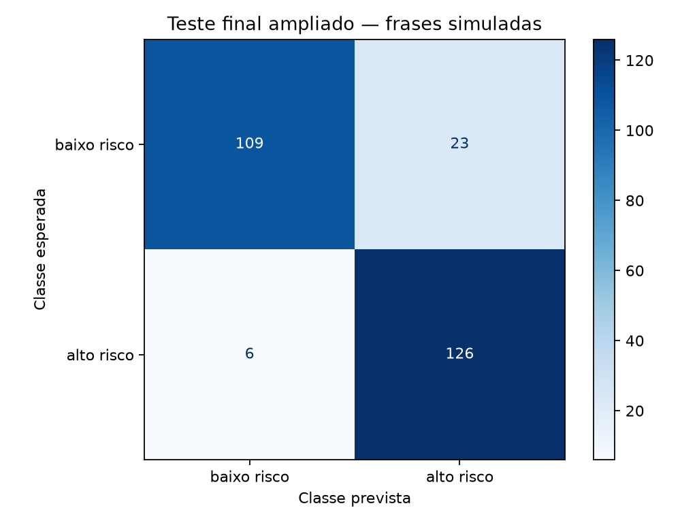

# PulseIA — Fase 2

## Diagnóstico Automatizado — IA no Estetoscópio Digital

O módulo associa sintomas a possíveis condições por regras e classifica frases
simuladas em `alto risco` ou `baixo risco` com TF-IDF e Regressão Logística. É
um projeto acadêmico: não realiza diagnóstico nem orienta atendimento.

## Entregáveis originais

| Critério | Arquivo |
| --- | --- |
| 10 relatos completos | [relatos_sintomas.txt](data/relatos_sintomas.txt) |
| Mapa de conhecimento | [mapa_conhecimento.csv](data/mapa_conhecimento.csv) — 83 associações |
| Extração de sintomas | [extrair_sintomas.py](src/extrair_sintomas.py) |
| Frases e rótulos | [frases_risco.csv](data/frases_risco.csv) — 992 frases, 496 por classe |
| Partições por cenário | [particoes.csv](data/particoes.csv) |
| Notebook TF-IDF e avaliação | [classificador_risco.ipynb](notebooks/classificador_risco.ipynb) |
| Vídeo da entrega avaliada | [YouTube não listado](https://youtu.be/L3uZMKG7ZUc) — 3min07s |

## Revisão após a avaliação

A entrega recebeu nota máxima e foi preservada na branch `fase2-entrega`. Esta
branch aplica todas as recomendações do professor antes do início da Fase 3.
O [quadro de mudanças](docs/feedback_fase2.md) relaciona cada recomendação à
implementação e ao limite que ainda permanece.

Principais acréscimos:

- base principal ampliada de 288 para 992 frases, incluindo 576 novos relatos com variações de fala e escrita;
- teste final ampliado de 24 para 264 frases, separadas por família de cenário;
- 32 cenários de avaliação baseados em fontes externas;
- 16 pares de manifestações leves e graves com linguagem semelhante;
- tratamento de dupla negação e sinalização de relatos contraditórios;
- investigação por termos dos erros, inclusive os dois falsos positivos antigos;
- auditoria com 48 variações sintéticas de sexo referido e faixa etária;
- calibração experimental das probabilidades e curva de confiabilidade;
- ficha de revisão clínica para todas as 83 associações.

A validação por profissional de saúde não foi inventada: ela continua marcada
como `pendente` em [revisao_clinica.csv](data/revisao_clinica.csv), com o
[procedimento de validação](docs/validacao_clinica.md) preparado. Pelo mesmo
motivo, a avaliação baseada em fontes não é chamada de independente; o
[protocolo para coleta externa](docs/avaliacao_independente.md) registra como
essa etapa deverá ser concluída sem vazamento.

## Execução

Na raiz do repositório, com Python 3.13:

```bash
python3 -m venv .venv
source .venv/bin/activate
python -m pip install -r fase2/requirements.txt
python fase2/src/extrair_sintomas.py
python fase2/src/executar_notebook.py
python -m unittest discover -s fase2/tests -v
python scripts/verificar_entrega.py
```

`extrair_sintomas.py` lê os dez relatos, procura expressões do mapa e salva
`outputs/diagnosticos_sugeridos.csv`. A saída agora separa sintomas afirmados,
negados e contraditórios. Cada linha do mapa exige a presença dos dois sintomas;
uma frase pode receber mais de uma associação.

O modo interativo continua disponível:

```bash
python fase2/src/extrair_sintomas.py --interativo
```

Três campos coletam sintomas, impacto na rotina e tempo de início. O envio fica
em arquivos locais ignorados pelo Git, sem alterar os dez relatos obrigatórios.

`executar_notebook.py` executa todas as células e atualiza as tabelas e figuras.
Para reproduzir também os arquivos de avaliação diretamente:

```bash
python fase2/src/avaliar_classificador.py
```

O gerador `expandir_linguagem.py` recria as 576 frases adicionais e o manifesto
de partições a partir da base anterior; `criar_notebook.py` recria o notebook
didático antes de executá-lo. Os dois são determinísticos.

## Resultados da revisão

| Conjunto | Casos | Acurácia | Recall de alto risco |
| --- | ---: | ---: | ---: |
| Teste final ampliado | 264 | 89,0% | 95,5% |
| Avaliação baseada em fontes externas | 32 | 96,9% | 100% |
| Pares de gravidade | 32 | 90,6% | 100% |
| Regressão | 144 | 95,8% | 97,2% |

No teste final ocorreram seis falsos negativos e 23 falsos positivos. Há 44
frases com erro ortográfico e 44 com fala coloquial no teste. A acurácia ficou
em 88,6% em ambos os subconjuntos. As 264 frases são variações de apenas 22
famílias novas, portanto não equivalem a 264 casos independentes. A análise
completa está em [avaliacao.md](docs/avaliacao.md).



## Probabilidades e vieses

A probabilidade produzida é confiança estatística dentro desta base. Não é risco
clínico. A calibração usa 88 frases reservadas e serve para estudo; Brier score e
log loss não garantem segurança médica.

Os testes de subgrupos não encontraram diferença entre as variações testadas,
mas usam frases sintéticas pareadas. Eles não avaliam representatividade,
prevalência, raça/cor, território, renda ou desfechos de pacientes e não
demonstram fairness. Fontes e limitações estão em
[dados_e_limites.md](docs/dados_e_limites.md).
