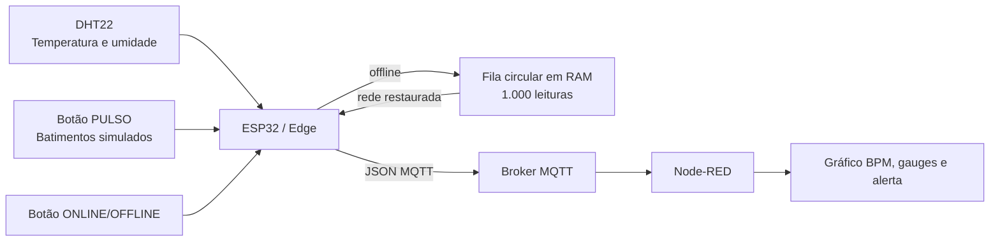

# Fase 3 — Monitoramento Contínuo: IoT no Pulso do Paciente

> Protótipo acadêmico do CardioIA — PulseIA. As leituras são simuladas e não
> constituem monitoramento médico, diagnóstico ou alerta clínico real.

Esta fase simula um dispositivo vestível com ESP32 que coleta temperatura,
umidade e pulsos, mantém leituras em uma fila local durante uma queda de rede,
publica mensagens MQTT e as exibe em um dashboard Node-RED.

## Entregas

| Item | Arquivo / acesso |
| --- | --- |
| Projeto ESP32 + Wokwi | [esp32-cardioia](esp32-cardioia/) |
| Link público do Wokwi | A publicar após a execução no simulador |
| Código C++ comentado | [main.cpp](esp32-cardioia/src/main.cpp) |
| Circuito do simulador | [diagram.json](esp32-cardioia/diagram.json) |
| Fluxo importável do dashboard | [flows_cardioia.json](node-red/flows_cardioia.json) |
| Instruções do Node-RED | [README do dashboard](node-red/README.md) |
| Relatório Edge Computing | [relatorio_edge.md](docs/relatorio_edge.md) |
| Relatório MQTT e dashboard | [relatorio_mqtt_dashboard.md](docs/relatorio_mqtt_dashboard.md) |
| Relatórios paginados para entrega | [Edge (PDF)](output/pdf/relatorio_edge_computing.pdf) e [MQTT/dashboard (PDF)](output/pdf/relatorio_mqtt_dashboard.pdf) |
| Checklist do enunciado | [checklist_enunciado.md](docs/checklist_enunciado.md) |
| Segurança, privacidade e limites | [seguranca_privacidade.md](docs/seguranca_privacidade.md) |
| Roteiro de evidências | [roteiro_evidencias.md](docs/roteiro_evidencias.md) |
| Pasta para capturas reais | [evidencias](evidencias/) |
| Verificação automática | `python fase3/scripts/verificar_fase3.py` |
| Resultado da compilação | [validacao_tecnica.md](docs/validacao_tecnica.md) |

## Arquitetura e fluxo



O DHT22 é o sensor obrigatório e fornece temperatura e umidade. O botão
`PULSO` é o segundo sensor, simulando cada batimento; a contagem em janelas de
dez segundos é convertida para BPM. O botão `ONLINE/OFFLINE` não é sensor
clínico: ele controla uma variável booleana para reproduzir perda e retorno de
conectividade.

## Resiliência no Edge

Uma amostra é feita a cada cinco segundos. Toda leitura entra em uma fila
circular limitada a 1.000 amostras — aproximadamente 83 minutos de histórico
offline. Ao atingir o limite, a estratégia de negócio é substituir a leitura
mais antiga para preservar o estado mais recente do paciente e impedir falta de
memória.

Quando a rede volta, o ESP32 tenta enviar a primeira mensagem pendente. Ela é
removida da fila **somente** depois que `mqtt.publish()` aceita a mensagem para
transmissão. Se houver falha local, o restante é preservado para a próxima
tentativa. Como a biblioteca usa QoS 0, esse retorno não é uma confirmação de
armazenamento pelo broker. O Monitor Serial mostra o tamanho da fila e as
leituras transmitidas.

No Wokwi, esta fila fica em RAM porque o SPIFFS do simulador não oferece a
persistência necessária entre execuções. Em uma placa real, a mesma interface
de fila pode ser gravada em SPIFFS ou microSD antes da sincronização. Essa
limitação e a escolha são detalhadas no [relatório Edge](docs/relatorio_edge.md).

## Executar o ESP32

### Wokwi

1. Abra a pasta `fase3/esp32-cardioia` no VS Code com a extensão Wokwi e o
   PlatformIO instalados.
2. Compile o projeto e inicie o simulador. O circuito está definido em
   `diagram.json` e os parâmetros em `wokwi.toml`.
3. Abra o Monitor Serial em 115200 baud.
4. Pressione `PULSO` algumas vezes; após dez segundos, o código calcula BPM.
5. Pressione `ONLINE/OFFLINE`, espere duas leituras e pressione novamente para
   observar a fila ser sincronizada.

O [formato do circuito do Wokwi](https://docs.wokwi.com/diagram-format) e a
[configuração de projetos com VS Code](https://docs.wokwi.com/vscode/project-config)
foram consultados para estruturar os arquivos do simulador. A conexão usa a
rede aberta `Wokwi-GUEST` e o canal 6 conforme o
[guia de Wi-Fi do ESP32 no Wokwi](https://docs.wokwi.com/guides/esp32-wifi).

### Broker MQTT

Por padrão, o protótipo usa `broker.hivemq.com:1883`, sem dados pessoais, para
uma demonstração simples e pública. Antes de apresentar a versão final em uma
conta própria, substitua as configurações por HiveMQ Cloud ou outro broker
privado com TLS. Copie
[config.h.example](esp32-cardioia/include/config.h.example) para
`config.local.h` e preencha os campos. Esse arquivo local é ignorado pelo Git;
credenciais reais não devem entrar no repositório.

O HiveMQ documenta a configuração de cluster Cloud na porta 8883 e o uso de
TLS para proteger a conexão; veja a [documentação de bridge MQTT](https://docs.hivemq.com/hivemq-edge/mqtt-bridging.html)
e as [orientações de segurança](https://docs.hivemq.com/hivemq/latest/user-guide/security.html).

## Dashboard Node-RED

Importe [flows_cardioia.json](node-red/flows_cardioia.json) conforme o
[guia do dashboard](node-red/README.md). A interface exibe:

- gráfico temporal de BPM;
- medidor de temperatura e medidor complementar de umidade;
- texto de alerta para temperatura maior ou igual a 38 °C ou BPM maior ou igual
  a 120;
- quantidade de mensagens aguardando sincronização no Edge;
- painel Debug para conferir o JSON original.

O export também inclui dois botões de teste no editor do Node-RED. Eles enviam
uma leitura normal e uma leitura em alerta diretamente ao painel, permitindo
validar os widgets antes de conectar o Wokwi.

## Formato da mensagem

Exemplo de payload publicado no tópico `cardioia/pulseia/v1/telemetria`:

```json
{
  "projeto": "CardioIA",
  "paciente_id": "PACIENTE_DEMO_001",
  "sequencia": 3,
  "instante_ms": 15000,
  "temperatura_c": 36.7,
  "umidade_pct": 52.1,
  "bpm": 72,
  "pulso_detectado": true,
  "alerta": false,
  "fila_offline": 0,
  "amostras_descartadas": 0,
  "origem": "edge_esp32"
}
```

## Limites do protótipo

Os sensores e os dados do Wokwi são simulados. O botão não substitui um sensor
de frequência cardíaca, e os limites configurados são apenas parâmetros de
demonstração. A publicação MQTT confirma aceitação pelo cliente/broker, não
equivale à entrega clínica garantida. Para uso real seriam necessários sensores
validados, armazenamento persistente, autenticação, TLS, controle de acesso,
monitoramento operacional e validação profissional. Consulte
[segurança e privacidade](docs/seguranca_privacidade.md).

## Situação da entrega

O código, o circuito, o export do dashboard e os relatórios estão no
repositório. Permanecem como ações externas obrigatórias: executar o protótipo,
publicar o link do Wokwi e salvar as capturas reais da aplicação. O
[checklist do enunciado](docs/checklist_enunciado.md) separa claramente o que já
está comprovado nos arquivos e o que depende dessa execução.

Os PDFs podem ser regenerados depois de qualquer mudança nos textos com
`pip install -r fase3/requirements-dev.txt` e
`python fase3/scripts/gerar_relatorios_pdf.py`.
