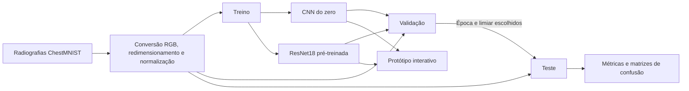

# FIAP - Faculdade de Informática e Administração Paulista

<p align="center">
  <a href="https://www.fiap.com.br/"></a>
</p>

# CardioIA — PulseIA

## Grupo - PulseIA

## 👨‍🎓 Integrantes

- Erik Criscuolo
- [Marcus Vinícius Loureiro Garcia](https://www.linkedin.com/in/marcusvlgarcia/)
- [Sidney William de Paula Dias](https://www.linkedin.com/in/sidneywilliamdepaula/)

## 👩‍🏫 Professores

### Tutor

- [Leonardo Ruiz Orabona](https://www.linkedin.com/in/leonardoorabona/)

### Coordenador

- [André Godoi Chiovato](https://www.linkedin.com/in/andregodoichiovato/)

## Fase 4 — Coração em Imagens: Diagnóstico com Visão Computacional

> Protótipo acadêmico do CardioIA — PulseIA. A demonstração usa radiografias
> públicas e serve para estudo de Visão Computacional.

A Fase 4 classifica radiografias de tórax conforme o rótulo de cardiomegalia
do ChestMNIST. Os exames de origem são reais, e os rótulos vieram de
relatórios radiológicos processados automaticamente.

## Entregas

| Item | Arquivo / acesso |
| --- | --- |
| Pré-processamento | [Notebook 01](notebooks/01_preprocessamento.ipynb) · [Abrir no Colab](https://colab.research.google.com/github/marcus-vlgarcia/cardioia/blob/fase4/fase4/notebooks/01_preprocessamento.ipynb) |
| Relatório de preparação | [PDF](output/pdf/relatorio_preprocessamento.pdf) |
| CNN do zero e Transfer Learning | [Notebook 02](notebooks/02_treinamento_avaliacao.ipynb) · [Abrir no Colab](https://colab.research.google.com/github/marcus-vlgarcia/cardioia/blob/fase4/fase4/notebooks/02_treinamento_avaliacao.ipynb) |
| Prints e evidências das métricas | [Comparativo](resultados/metricas.png) · [Matrizes](resultados/matrizes_confusao.png) · [Curva precisão × recall](resultados/curva_precisao_recall.png) · [Comparação extra da CNN](resultados/comparacao_cnn.png) |
| Verificação dos arquivos | `python fase4/src/verificar.py` |
| Protótipo interativo | [Notebook 03](notebooks/03_prototipo.ipynb) · [Abrir no Colab](https://colab.research.google.com/github/marcus-vlgarcia/cardioia/blob/fase4/fase4/notebooks/03_prototipo.ipynb) |

## Arquitetura e fluxo



## Como executar

Abra um notebook no Google Colab pela opção **Arquivo → Abrir notebook →
GitHub**. Selecione este repositório e a branch da Fase 4. Execute as células em
ordem. Para treinar novamente no Notebook 02, habilite uma GPU no Colab e altere
`REPETIR_TREINO` para `True`. Os resultados e pesos desta execução já estão
versionados para consulta.

Para executar o treinamento localmente, a partir da raiz do repositório:

```bash
python -m pip install -r fase4/requirements.txt
python fase4/src/treinar.py
python fase4/src/verificar.py
```

O pipeline usa `curl` para baixar cerca de 402 MB de imagens do Zenodo e
verifica o arquivo com o checksum oficial. Os pesos ImageNet da ResNet18 são
baixados e verificados na primeira execução.
O protótipo inclui seis imagens do teste, sorteadas com semente fixa, três por
rótulo. Ele carrega apenas esses exemplos e os pesos necessários para inferência.
O avaliador pode escolher o exame e alternar entre a CNN de referência, a
ResNet18 e a CNN com mais negativos. Cada modelo usa o próprio limiar,
definido na validação. Os escores servem para a demonstração.

## Dados e avaliação

Usamos a coluna de cardiomegalia da ChestMNIST 64 × 64. O pipeline converte
as radiografias para RGB, redimensiona para 56 × 56 e normaliza os valores.
Na ResNet18 também é aplicada a normalização do ImageNet. Aumentos leves de
rotação, deslocamento, escala e intensidade são aplicados somente no treino,
preservando a orientação do exame.

| Partição | Exames | Com rótulo de cardiomegalia |
| --- | ---: | ---: |
| Treino | 9.750 | 1.950 |
| Validação | 7.997 | 179 |
| Teste reservado da revisão | 14.432 | 392 |

A partição de treino usa quatro negativos por positivo. A validação parte de
8.000 exames sorteados na partição oficial. O teste da revisão usa o restante
da partição oficial, após excluir os 8.000 índices sorteados na primeira
avaliação e cópias exatas dessas imagens. A deduplicação por SHA-256 também
remove cópias dentro e entre partições. O NPZ contém imagens e rótulos. A análise complementar usa o índice oficial do
MedMNIST para conferir a separação por paciente.

A CNN simples começa com pesos aleatórios. A ResNet18 parte de pesos ImageNet
e ajusta o último bloco e a saída, mantendo os primeiros blocos fixos.
Ambos recebem os mesmos exames. A melhor época é selecionada por *Average
Precision* na validação, e o limiar é escolhido pelo F1 positivo nessa mesma
partição. O teste fica reservado para medir os resultados dessa configuração.
Os pesos e limiares do commit inicial `cb3cc82` foram reaplicados ao mesmo
teste da revisão para permitir uma comparação direta.

| Modelo no mesmo teste | Acurácia | Acurácia balanceada | Precisão positiva | Recall positivo | F1 positivo | AP |
| --- | ---: | ---: | ---: | ---: | ---: | ---: |
| Classe majoritária | 97,28% | 50,00% | 0% | 0% | 0% | 0,027 |
| CNN inicial | 95,35% | 63,39% | 22,70% | 29,59% | 25,69% | 0,180 |
| **CNN revisada** | 94,91% | **66,26%** | 22,60% | **35,97%** | **27,76%** | **0,212** |
| ResNet18 inicial | 92,75% | 56,47% | 8,92% | 18,11% | 11,95% | 0,061 |
| **ResNet18 ajustada** | 92,36% | **63,34%** | **13,25%** | **32,65%** | **18,85%** | **0,116** |

A CNN revisada encontrou 141 dos 392 exames com rótulo, ante 116 na versão
inicial. O ganho de 25 acertos positivos veio acompanhado de 88 falsos
positivos adicionais. A ResNet18 ajustada encontrou 128, ante 71, e teve
113 falsos positivos adicionais. A acurácia global caiu nos dois modelos
porque os negativos predominam no teste. A acurácia balanceada dá o mesmo
peso ao recall de cada classe. O desempenho ainda é limitado, como mostram
os 251 falsos negativos da CNN revisada.

Cada linha de [predições de teste](resultados/predicoes_teste.csv) informa
o índice oficial do exame, seu rótulo e os escores dos quatro modelos.
O [registro de métricas](resultados/metricas.json) traz as métricas por classe,
os limiares e o histórico de validação.

A ausência do rótulo significa apenas que a base não registra cardiomegalia
para aquele exame. A resolução reduzida, os rótulos extraídos automaticamente
e o uso de uma única base limitam a interpretação. A comparação é interna e
os resultados servem para o exercício acadêmico.

Fontes: [MedMNIST](https://medmnist.com/), [metadados oficiais e licença CC BY 4.0](https://github.com/MedMNIST/MedMNIST/blob/main/medmnist/info.py),
[distribuição Zenodo](https://zenodo.org/records/10519652) e
[pesos ResNet18 do Torchvision](https://docs.pytorch.org/vision/stable/models/generated/torchvision.models.resnet18.html).

## Análise complementar da CNN

O índice oficial do MedMNIST liga cada imagem à radiografia de origem no NIH.
Usamos o identificador no nome do exame para agrupar as radiografias por
paciente. Na avaliação anterior, um paciente tinha imagens tanto na validação
quanto no teste. Excluímos os 36 exames dele do teste comparativo, que ficou com
14.396 radiografias de 4.776 pacientes, incluindo 391 exames com o rótulo.

Mantivemos a arquitetura da CNN e treinamos uma candidata com 7.800 negativos
adicionais, passando de quatro para oito negativos por positivo. Os novos
exemplos vieram da partição de treino, sem repetir imagens ou pacientes da
validação ou do teste. A época do novo treino foi selecionada pela AP na
validação e o limiar pelo F1 positivo. As duas CNNs foram comparadas no mesmo
recorte de teste, já conhecido da avaliação anterior. É uma comparação interna
retrospectiva.

A AP na validação passou de 0,176 para 0,184. Esse foi o critério para
selecionar a candidata antes de calcular as métricas do teste comparativo.

| Modelo | Acurácia | Acurácia balanceada | Precisão positiva | Recall positivo | F1 positivo | AP |
| --- | ---: | ---: | ---: | ---: | ---: | ---: |
| CNN de referência | 94,91% | **66,31%** | 22,60% | **36,06%** | 27,78% | 0,212 |
| CNN com mais negativos | **96,61%** | 62,21% | **33,78%** | 25,83% | 29,28% | **0,227** |

A candidata teve 198 falsos positivos, ante 483 na referência. Em contrapartida,
identificou 101 dos 391 positivos, ante 141 na referência. Nesse teste, o ganho
de acurácia foi de 1,70 ponto percentual, com intervalo de 95% de 1,36 a 2,03
pontos. O F1 subiu na estimativa pontual, mas o intervalo da diferença inclui
zero. Um classificador que sempre prevê a classe majoritária teria 97,28% de
acurácia e recall positivo zero. O protótipo mantém a CNN de referência como
opção inicial, pois ela identificou mais positivos.

Os [escores por exame](resultados/predicoes_comparacao_cnn.csv) e o
[registro completo](resultados/comparacao_cnn.json) permitem reproduzir as
métricas. Os intervalos de 95% para as diferenças foram estimados em 2.000
reamostragens pareadas de pacientes, mantendo juntos os exames da mesma pessoa.
O [Notebook 02](notebooks/02_treinamento_avaliacao.ipynb) exibe a comparação
e permite repetir o experimento com `REPETIR_COMPARACAO = True`.

Fontes da auditoria e da avaliação
[Índice oficial do MedMNIST](https://github.com/MedMNIST/MedMNIST#data-files),
[NIH Clinical Center](https://nihcc.app.box.com/v/ChestXray-NIHCC) e
[ajuste de limiar no Scikit-learn](https://scikit-learn.org/stable/modules/classification_threshold.html).

## Checklist do enunciado

- [x] Dataset público de radiografias, com fonte e licença.
- [x] Conversão para RGB, redimensionamento, normalização e partições
  de treino, validação e teste.
- [x] Notebook de pré-processamento para Colab e relatório de uma página.
- [x] CNN treinada do zero e Transfer Learning com ajuste parcial da ResNet18.
- [x] Notebook com treinamento, resultados, acurácia, matriz de confusão,
  precisão, recall e F1 por classe.
- [x] Capturas das métricas e notebook interativo para apresentar a classificação.

## Licença

O modelo de README segue o [MODELO GIT FIAP](https://github.com/agodoi/template),
licenciado sob [CC BY 4.0](https://creativecommons.org/licenses/by/4.0/).
As fontes e condições de uso dos dados estão registradas na seção de dados
deste README e no [registro geral de fontes](../docs/fontes.md).
